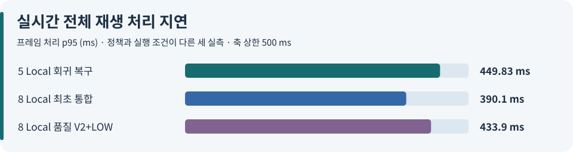

# 이벤트 기반 실시간 구조

[보고서 색인](README.md)

## 수행한 연구

이벤트·다중속도 실행과 게시 주기, 큐 부하를 비교했다. 계산 절약과 상태 출력 동등성을 별개로 측정했다.

## 해석 범위

캐시 성능과 실제 입력·GPU·게시를 포함한 지연을 구분한다.

## 시각 자료

## 정리한 로컬 문서

- `REALTIME_ARCHITECTURE_REPORT_ko.md`

이 문서는 관련 로컬 보고서의 GitHub용 요약이다. 같은 제목의 사본과 중간 체크포인트는 최종 연구 판단 아래 함께 색인했다.
