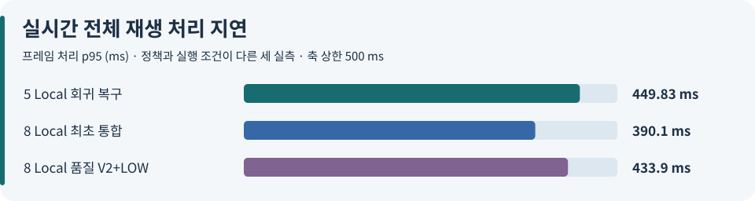

# 장시간 페이싱과 화면 세대 안전성

[보고서 색인](README.md)

## 수행한 연구

장시간 입력, 큐·지연, 장면 변경, 지연된 처리 결과 폐기 조건을 점검했다. 별도 단기 통합 시험과 지연 꼬리 분석을 남겼다.

## 해석 범위

실측 조건 밖의 화면 전환이나 장치에서는 추가 확인이 필요하다.

## 시각 자료

## 정리한 로컬 문서

- `CAMERA_SCENE_IDENTITY_REPORT_ko.md`
- `REALTIME_20MIN_STABILITY_REPORT_ko.md`
- `TAIL_LATENCY_ROOT_CAUSE_ko.md`

이 문서는 관련 로컬 보고서의 GitHub용 요약이다. 같은 제목의 사본과 중간 체크포인트는 최종 연구 판단 아래 함께 색인했다.
