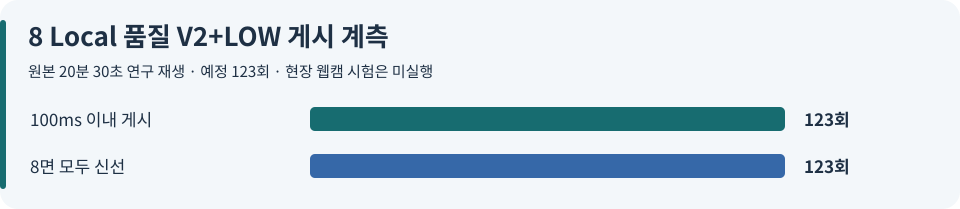

# 점유 엔진과 화면 보호 통합

[보고서 색인](README.md)

## 수행한 연구

실제 페이싱에서 점유 처리와 화면 세대 보호를 통합했다. 장시간 메모리 증가를 계측하고 캐시 재계산과 새 GPU 검증을 분리했다.

## 해석 범위

제한된 실행 시간에서의 메모리 관측으로 상한을 보장할 수 없다.

## 시각 자료

## 정리한 로컬 문서

- `INTEGRATED_OCCUPANCY_REALTIME_REPORT_ko.md`
- `MEMORY_GROWTH_ROOT_CAUSE_ko.md`

이 문서는 관련 로컬 보고서의 GitHub용 요약이다. 같은 제목의 사본과 중간 체크포인트는 최종 연구 판단 아래 함께 색인했다.
