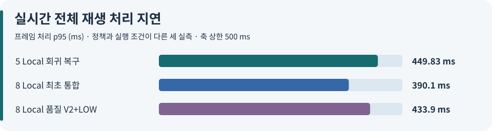

# 5 Local 통합 회귀 복구

[보고서 색인](README.md)

## 수행한 연구

기존 출차·점유 근거를 보호하는 5 Local 통합에서 2,460개 입력과 123회 게시의 완료를 기록했다.

## 해석 범위

AUTO_POINT, EMPTY 참고 영상, 초기 차량 지정의 조건을 따로 평가했다.

## 시각 자료

## 정리한 로컬 문서

- `INTEGRATION_REGRESSION_RECOVERY_ko.md`

이 문서는 관련 로컬 보고서의 GitHub용 요약이다. 같은 제목의 사본과 중간 체크포인트는 최종 연구 판단 아래 함께 색인했다.
