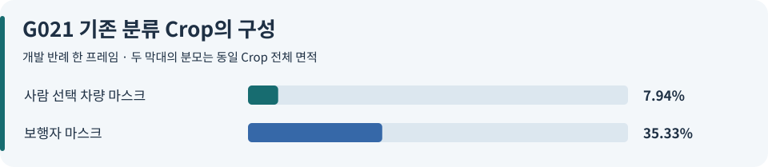

# 소유 불확실성과 점유 증거 분리

[보고서 색인](README.md)

## 수행한 연구

소유 추적과 국소 점유의 증거를 분리했다. 처음에는 검토에서 선택했던 큰 차량과 기준점 인근의 작은 검출을 비교했다. 후속 사용자 정정에서 왼쪽 작은 검출이 G021 차량으로 확인돼, 해당 프레임의 BASELINE 차량 선택은 일치로 수정했다. [정정 후 정책 감사](47-g021-reacquisition.md)

## 해석 범위

소유 판단을 보류한 채 현재 점유를 기록할 수 있으나 직접 관측이 부족하면 UNKNOWN이다.

## 시각 자료

## 비식별 CCTV 발췌

G021 공간 대응 진단에 사용한 영상의 배경과 모아레 예시다. 가림으로 숨긴 영역은 이 사본으로 판독할 수 없다.

## 정리한 로컬 문서

- `G021_OCCUPANCY_LOSS_ROOT_CAUSE_ko.md`

이 문서는 관련 로컬 보고서의 GitHub용 요약이다. 같은 제목의 사본과 중간 체크포인트는 최종 연구 판단 아래 함께 색인했다.
