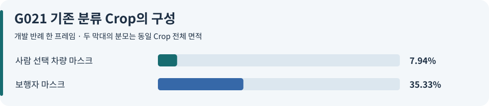
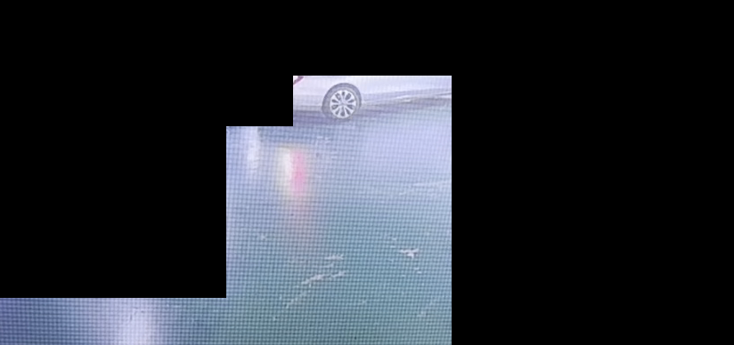

# 기준점·마스크·물리 바닥의 대응

[보고서 색인](README.md)

## 수행한 연구

원본과 ROI의 위치 변환을 감사했다. 점 중심 Crop은 선택 차량 마스크를 일부만 보고 보행자 가림을 많이 포함했다. 출차 후 점유 제안도 별도 점검했다.

## 해석 범위

물리 바닥 경계가 확인되지 않아 기준점 변경과 새 점유 확정을 보류했다.

## 시각 자료

## 비식별 CCTV 발췌

G021 공간 대응 진단에 사용한 영상의 배경과 모아레 예시다. 가림으로 숨긴 영역은 이 사본으로 판독할 수 없다.

차체 일부와 통로가 보이는 장면이다. 이 사본만으로 물리 소유나 입차 시각을 확정할 수 없다.

## 정리한 로컬 문서

- `G021_SPATIAL_CORRESPONDENCE_REPORT_ko.md`

이 문서는 관련 로컬 보고서의 GitHub용 요약이다. 같은 제목의 사본과 중간 체크포인트는 최종 연구 판단 아래 함께 색인했다.
