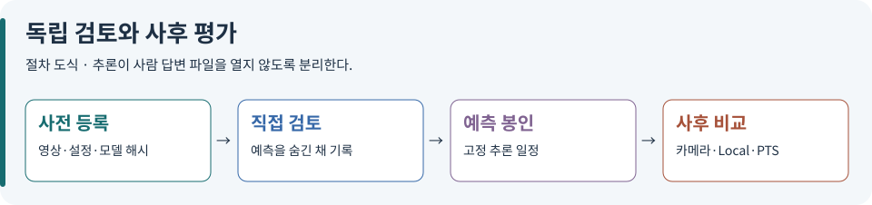
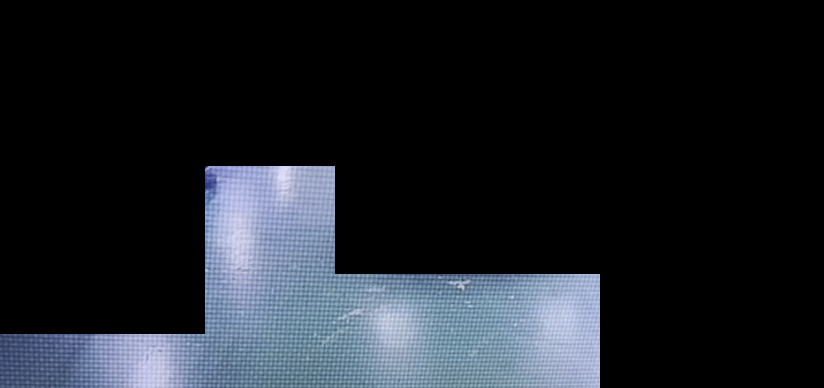
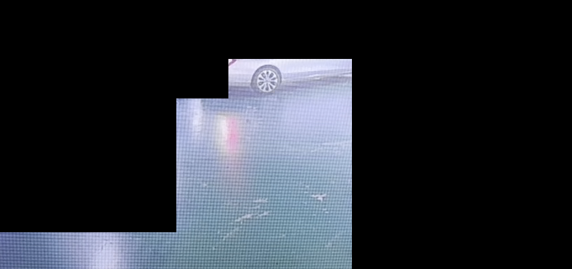

# Polygon 검토와 AI 초안 승인

[보고서 색인](README.md)

## 수행한 연구

실제 바닥 경계를 표시하는 검토 화면을 만들고 입력 출처를 추적했다. 새 바닥 답변은 확인 가능한 Polygon을 만들지 못했다.

## 해석 범위

AI 초안 승인 자료와 직접 블라인드 자료를 구분한다.

## 시각 자료

## 비식별 CCTV 발췌

G021 공간 대응 진단에 사용한 영상의 배경과 모아레 예시다. 가림으로 숨긴 영역은 이 사본으로 판독할 수 없다.

차량과 주변 영역을 넉넉하게 가린 예시다. 점유 판정의 근거는 해당 보고서의 동결 평가를 참고한다.

차체 일부와 통로가 보이는 장면이다. 이 사본만으로 물리 소유나 입차 시각을 확정할 수 없다.

## 정리한 로컬 문서

- `PHYSICAL_SLOT_REGION_REVIEW_PLAN_ko.md`
- `REVIEW_COMPLETION_REPORT_ko.md`

이 문서는 관련 로컬 보고서의 GitHub용 요약이다. 같은 제목의 사본과 중간 체크포인트는 최종 연구 판단 아래 함께 색인했다.
