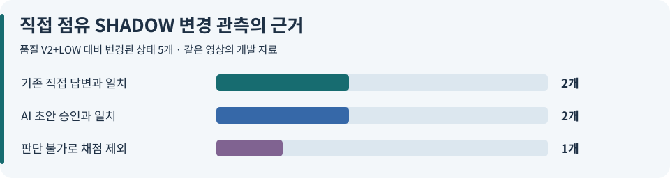
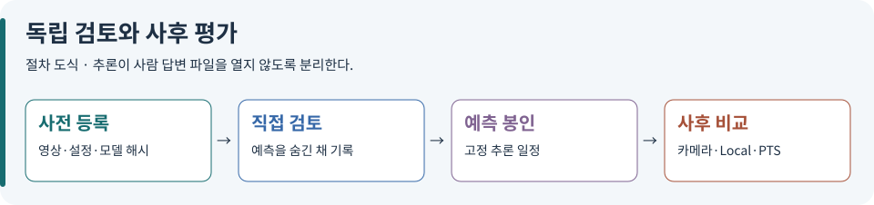
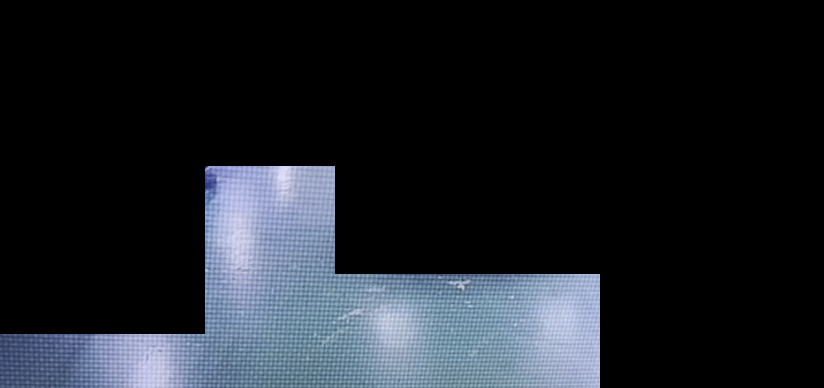
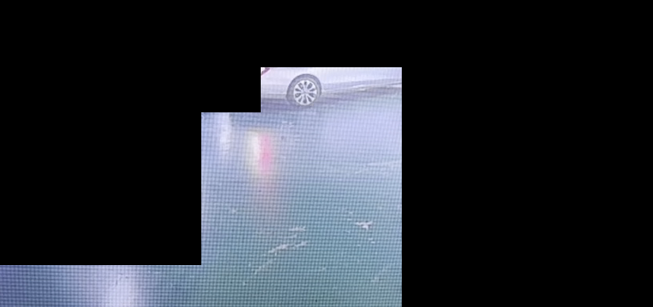

# Polygon 검토 사후평가

[보고서 색인](README.md)

## 수행한 연구

최종 봉인을 기준으로 동결 예측과 정확 시점에서 비교했다. 새 점유 승인 두 건과 직접 점유 SHADOW가 일치했다. 결정 불가 답변은 채점에서 제외했다.

## 해석 범위

점유 일치는 차량 소유 연결의 검증을 대신하지 않는다. 바닥 Polygon은 미확보였다.

## 시각 자료

## 비식별 CCTV 발췌

차량과 주변 영역을 넉넉하게 가린 예시다. 점유 판정의 근거는 해당 보고서의 동결 평가를 참고한다.

차체 일부와 통로가 보이는 장면이다. 이 사본만으로 물리 소유나 입차 시각을 확정할 수 없다.

## 정리한 로컬 문서

- `FIELD_DATA_REQUIREMENTS_ko.md`
- `G021_POLYGON_UNRESOLVED_ko.md`

이 문서는 관련 로컬 보고서의 GitHub용 요약이다. 같은 제목의 사본과 중간 체크포인트는 최종 연구 판단 아래 함께 색인했다.
