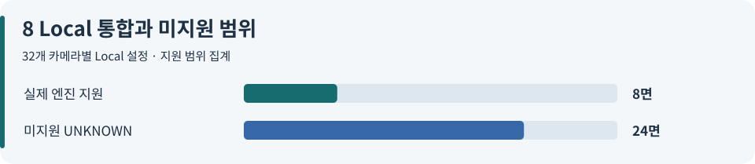
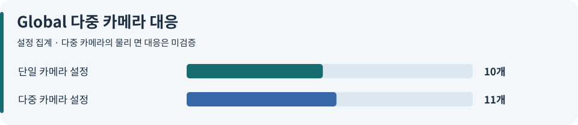
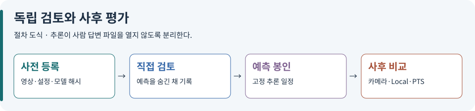

# 독립 현장 검증 준비

[보고서 색인](README.md)

## 수행한 연구

현장 수집 절차, Polygon·GT 검토, 검토자 불일치 처리, 동결 예측 비교, 다중 CCTV 대응 검토표를 구현했다. 650개 테스트와 SAFE 검사 통과를 기록했다.

## 해석 범위

합성 TEST_ONLY 검증을 완료했다. 현장 수집·정확도·실시간 검증에는 승인된 새 영상이 필요하다.

## 시각 자료

## 비식별 CCTV 발췌

G021 공간 대응 진단에 사용한 영상의 배경과 모아레 예시다. 가림으로 숨긴 영역은 이 사본으로 판독할 수 없다.

## 정리한 로컬 문서

- `FIELD_CAPTURE_PROTOCOL_ko.md`
- `FIELD_PRIVACY_AND_PERMISSION_CHECKLIST_ko.md`
- `FIELD_VALIDATION_READINESS_REPORT_ko.md`
- `INDEPENDENT_EVALUATION_METRICS_ko.md`

이 문서는 관련 로컬 보고서의 GitHub용 요약이다. 같은 제목의 사본과 중간 체크포인트는 최종 연구 판단 아래 함께 색인했다.
