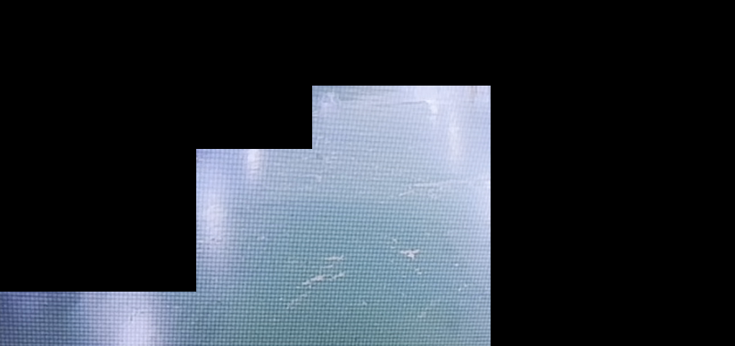

# G021 후보 Crop 재실험

[보고서 색인](README.md) · [후속 사용자 정정과 가림 분석](46-g021-occlusion-audit.md)

동일한 원본 영상의 개발 관측 **204프레임**에서 G021의 Crop만 바꿨다. 같은 기존 분류 배치와 가중치를 유지하고 분류 1,020배치를 실행했다. 각 후보는 연구용 입력으로만 비교했다.

| 대상 장면의 Crop 후보 | CNR | 증강 분류 |
|---|---:|---:|
| 기존 기준점 중심 | 0.0046 | 0.0016 |
| 경계 안쪽으로 확장 | 0.0065 | 0.0006 |
| 왼쪽 작은 검출 중심 | 0.0280 | 0.0028 |
| 왼쪽 작은 검출 상자만 | 0.1421 | 0.0203 |
| 큰 차량 중심 | 0.5665 | 0.5129 |

기존 Crop에는 왼쪽 검출 마스크가 전부 포함됐다. 이는 가림 뒤 검출기에 보인 마스크 범위다. 큰 차량 중심 Crop에서는 기존 엔진이 EMPTY로 출력한 다른 개발 관측 네 개에서 두 분류가 모두 0.8을 초과했다. 이 네 개는 동결 출력과의 충돌 후보로 기록했으며, 직접 EMPTY 정답을 새로 확정하지 않았다.

후속 사용자 정정에서 큰 차량은 인접 면으로, 왼쪽 차량은 G021로 확인됐다. 큰 차량 쪽의 Crop을 고치는 방향을 채택하지 않았다. 다음 연구는 기존 Crop에서 가림과 재확인 문제를 다룬다.

사진에서 검은 영역은 식별 가능성이 있는 부분을 가린 것이다. 사진과 표는 같은 개발 반례를 설명한다.
