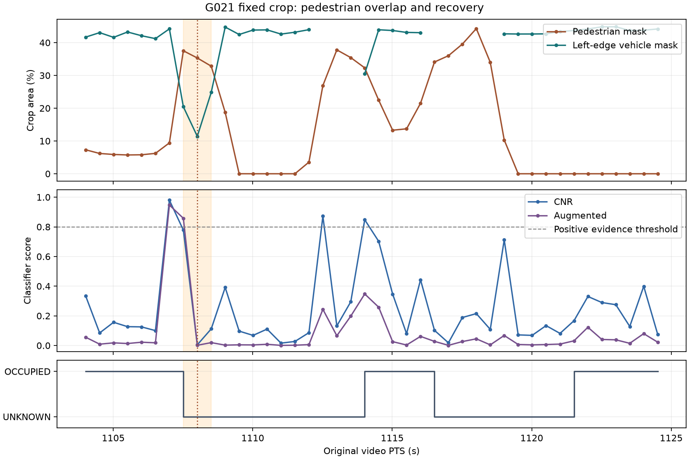

# G021 기존 Crop 가림 분석

[보고서 색인](README.md) · [후속 재확인 SHADOW](47-g021-reacquisition.md)

사용자 정정을 기준으로 왼쪽 아래 차량은 G021, 큰 상자의 차량은 인접 면으로 기록했다. 이 정정은 검토된 한 프레임에 해당한다. 이전에 인용한 약 9.8%는 큰 차량 마스크 중 기존 Crop에 들어온 비율이다. 따라서 G021 차량이 Crop에 얼마나 담겼는지 설명하는 근거에서 제외했다.

| 관측 구간 | Crop 내 보행자 마스크 | Crop 내 왼쪽 차량 마스크 | CNR / 증강 |
|---|---:|---:|---:|
| 가림 직전 | 9.42% | 44.21% | 0.980 / 0.947 |
| 문제 장면 | 35.33% | 11.42% | 0.005 / 0.002 |
| 보행자 마스크가 거의 사라진 직후 | 0.01% | 42.49% | 0.097 / 0.005 |

보행자가 기준점을 덮기 시작한 때 기존 품질 V2는 UNKNOWN으로 전환했다. 가림이 사라지고 왼쪽 차량 마스크 면적이 회복된 뒤에도 분류는 낮았다. 최초 전환 시점과 첫 OCCUPIED 복귀 사이가 약 6.50초였다. 가림은 최초 검출 근거 손실과 함께 발생했고, 이후의 낮은 점수와 재초기화 지연은 별도로 검토했다.

그래프는 표본별 마스크와 동결 출력을 같은 원본 PTS에 맞춘 것이다. 마스크가 기록되지 않은 왼쪽 검출 시점은 선의 빈 구간으로 남겼다.
