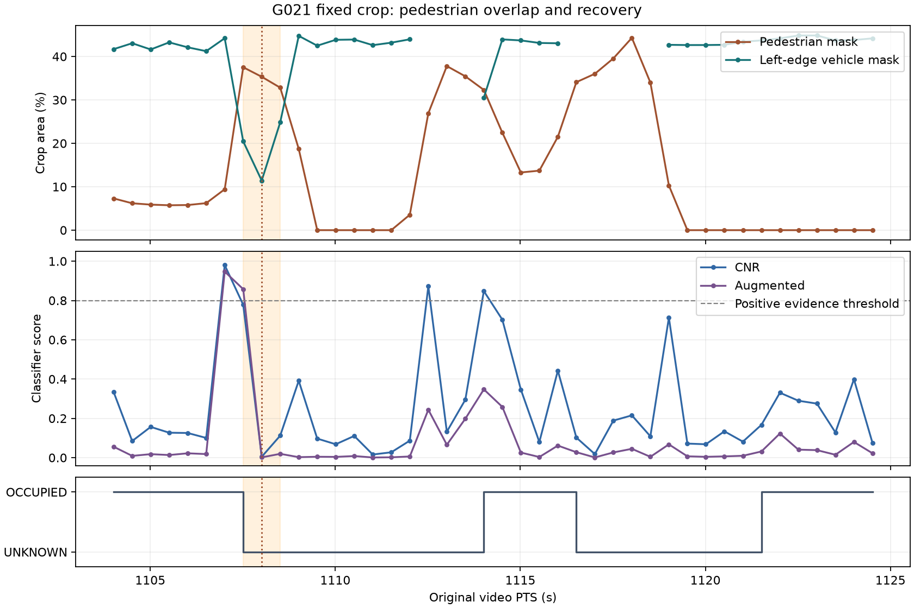

# G021 보행자 가림 후 차량 재확인

[보고서 색인](README.md) · [기존 Crop 가림 분석](46-g021-occlusion-audit.md)

사용자 정정 후 동결 정책 8개를 같은 프레임에서 다시 대조했다. BASELINE과 LOW_RECOVERY_ONLY는 G021 OCCUPIED와 일치했고 둘 다 정정된 왼쪽 검출을 선택했다. 인접 차량 상자와의 IoU는 0, 정정된 상자와의 IoU는 약 1.0이다. 해당 프레임의 오연결 판정을 바로잡았다. 나머지 여섯 정책의 UNKNOWN에는 비교할 차량 상자가 없었다.

| 후보 | 관측한 범위 |
|---|---|
| BASELINE | 정정된 프레임에서 왼쪽 G021 검출 선택 |
| OCCLUSION_AWARE | 보행자 마스크 기준점 가림을 두 관측에서 표시 |
| TRUSTED_VEHICLE_REACQUISITION | 가림 뒤 두 연속 관측이 위치·외관·참조 시간 기준을 충족 |
| OCCUPANCY_REVALIDATION | 두 분류의 기존 0.8 문턱과 지속 시간을 충족하지 못함 |

재연결 가설은 품질 V2의 OCCUPIED 복귀보다 약 **4.50초** 빨랐다. 해당 시점의 참조 상자 IoU는 0.855, 외관 히스토그램 교차는 0.912였다. 이는 차량 후보의 기하·외관 대응이며, 여러 시각에 걸친 물리 동일성은 미확정이다. 동시에 분류 확률은 0.097과 0.005였다. 더 빠른 점유 확정으로 이어지지 않아 상태 변경은 0건이었다.

새 점유 정책을 채택하지 않았다. 654개 단위 테스트와 SAFE 자체 검사를 통과했고, 기존 출차·빈자리·인접 차량 반례는 봉인 결과를 대조했다. GPU나 새 전체 8면 엔진 재계산은 미실행이다.

