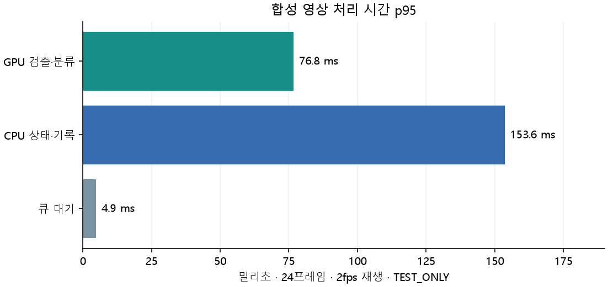

# 실제 현장 검증 착수 준비

[보고서 색인](README.md) · [현장 수집·정답 도구 준비](44-independent-field-validation.md) · [G021 보행자 가림 후 차량 재확인](47-g021-reacquisition.md)

승인된 웹캠 녹화 파일을 기존 8 Local 엔진과 독립 채점 도구에 연결했다. 패널과 ROI를 등록하면 원본 파일에서 PTS를 읽고 2fps 일정으로 추론한다. 검토자는 영상과 ROI를 보며 바닥 경계, 점유, 가시성, 차량 소유와 동일성을 입력한다. 채점은 추론과 별도 실행으로 진행하며, 봉인된 예측과 같은 카메라·Local·원본 PTS의 답변을 대조한다.

## 확인한 범위

| 항목 | 합성 기능 시험 결과 |
|---|---|
| 녹화 파일·패널·PTS | 960×540, 세 패널, 24/24프레임 처리, 누락 0 |
| 검토 화면과 저장 | 점유·소유·동일성과 Polygon 저장, 수정·복원 및 검토자 분리 |
| 예측·답변 봉인과 평가 | 합성 OCCUPIED·EMPTY 각 1개를 정상 대조, 가시성 부족 1개와 초기 입력 시점 답변 2개 제외 |
| 독립 10초 게시 | 1/1, 완료 지연 0.88ms |
| 지원 8면 관측 신선도 | 움직임을 넣은 합성 영상에서 1/1, 게시 완료 시 최대 관측 나이 0.501초 |
| 화면 전환 | 10.5초의 합성 CCTV3 교체 감지, 이후 해당 패널 출력 UNKNOWN |
| 단위·UI 및 SAFE 검사 | 658개 통과, SAFE 자체 검사 통과 |

정지 패널만 반복한 합성 시험에서는 화면 정지 의심이 발생해 신선도 게이트를 통과하지 못했다. 움직임을 넣은 시험의 처리 수치도 짧은 합성 파일에 한정된다. 두 합성 정답에 대한 모델 출력은 모두 UNKNOWN이었으며, 확정 출력 정확도의 분모는 0이다. 실제 점유·빈자리 정확도, 차량 소유 정확도, 현장 웹캠 지연, 장시간 메모리 안정성은 미측정이다.

이전 G018·G019·G020·G021·G027 핵심 회귀는 봉인된 기록으로 보존했다. G021 고정점과 Crop, G008·G026 반례와 G021 재확인 연구도 유지했다. 이번에 기존 영상 전체를 새로 추론하지 않았다. 점유 알고리즘, 운영 SAFE, 릴리스, 모델, 기존 GT의 변경은 없었다. 지원 8면 기준선만 새 파일과 연결했다. 미지원 24면은 UNKNOWN이고, 미검증 다중 CCTV 대응 11개와 물리 총주차대수는 미확정이다.

## 첫 현장 실행에 필요한 자료

1. 현장 이용 승인을 받은 새 녹화 파일에서 **확실한 빈 바닥과 실제 출차 전후**를 우선 확보한다. 이어 같은 면의 재입차, 가림, G021 왼쪽 가장자리, 패널 전환을 확보한다.
2. 같은 패널의 구획선·기둥 등으로 원근 변환과 기존 좌표의 물리 대응을 확인한다. 바닥 경계를 볼 수 있으면 Polygon을 직접 표시한다. 실제 OCCUPIED와 차량 소유·동일성은 별개로 기록한다.
3. 6개 AUTO_POINT 슬롯은 등록한 패널을 입력으로 사용한다. G020은 별도로 확인한 첫 프레임의 EMPTY 참고 영상, G027은 2fps 일정에 맞춘 화면 속 차량 상자가 필요하다. 입력이 비어 있으면 해당 슬롯은 UNKNOWN이다. 합성 시험은 두 조건의 전달과 채점 제외를 확인했다. G027 차량 상자의 실제 검출 연결은 합성 영상에서 성립하지 않았다.
4. 독립 채점은 AI 초안 없이 작성한 직접 답변으로 수행한다. 확정 출력 정확도는 정답이 있고 모델이 확정한 관측을 분모로 둔다. 정답 관측 확정률, UNKNOWN과 누락, 참 빈자리 중 잘못된 OCCUPIED와 참 점유 중 잘못된 EMPTY는 각각 별도로 보고한다. 차량 동일성은 모델에 명시적 물리 비교 출력이 없으므로 사람의 대응 확인이 필요하다.

촬영 권한과 신규 현장 영상이 확보되면 독립 평가를 시작할 수 있다. 이번 실행에서는 합성 자료만 사용했고 새 점유 정책의 운영 승격은 없다.
