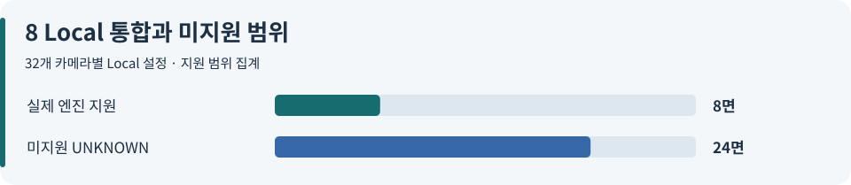
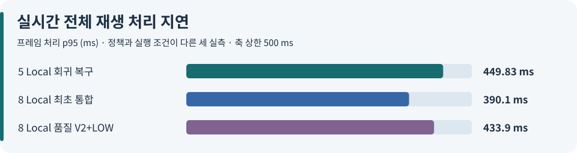
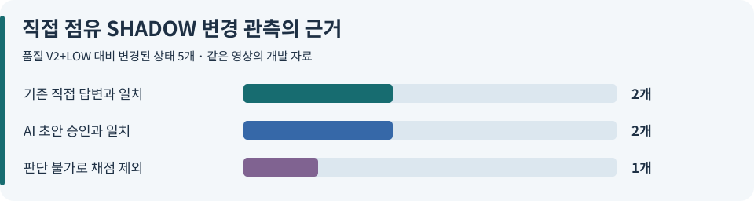

# 주차면 점유 연구 종합

[보고서 색인](README.md) · [기존 논문](../paper_ko.md)

## 연구 질문

관제 모니터를 촬영한 영상에서 카메라별 주차면 상태를 얼마나 안정적으로 판단할 수 있는가. 차량 검출, 물리 소유, 현재 점유와 빈자리, 실시간 게시를 서로 다른 검증 대상으로 다룬다.

## 연구 흐름

1. 저장 관측을 재생해 초기화와 연속 실행을 비교했다. 시간 분할을 바꿔도 같은 영상이라면 개발 자료로 관리했다.
2. 원본 프레임, 카메라 ROI, 기준점, 검출 상자와 마스크, 분류 입력의 대응을 확인했다. 잘린 Crop과 가림이 강할 때는 점 하나가 실제 주차면을 대표하지 못할 수 있었다.
3. 검출 결과와 물리 차량 소유를 분리했다. 낮은 신뢰도의 대상 검출이 빠지면 인접 후보를 잘못 연결할 수 있다. 제한적 복구와 신뢰 앵커를 연구하되 정지 이력이나 상자 겹침만으로 차량 동일성을 부여하지 않았다.
4. 점유와 빈자리를 분리했다. 빈자리에는 배경이나 실제 공간 노출 근거가 필요하다. 기존 차량 추적이 끊긴 사실은 빈자리의 근거가 될 수 없다.
5. 처리 입력 일정, 게시 시각과 관측 신선도를 계측했다. 화면 변경 시 카메라 세대를 갱신하고 이전 세대의 결과나 오래된 관측이 게시에 반영되지 않도록 연구했다.

## 확인한 범위

| 항목 | 기록된 결과 | 해석 |
|---|---|---|
| 지원 범위 | 실제 엔진 8 Local, 미지원 24 Local UNKNOWN | 설정상의 총 32 Local과 엔진 지원 범위를 구분한다 |
| 카메라 대응 | 설정상 21 Global, 다중 카메라 대응 11개 미검증 | 물리 면 대응 이전에는 중복 제거와 총 차량 수 산출을 보류한다 |
| 실시간 연구 재생 | 20분 30초, 2fps 입력 2,460개, 10초 게시와 지원 상태 신선도 각각 123/123 | 해당 영상과 하드웨어의 측정이다. 독립 현장 영상의 지연을 대신하지 않는다 |
| 후속 Polygon 검토 | 실제 바닥 Polygon 미확보. AI 초안 사용자 승인 점유 두 관측에서 직접 점유 SHADOW와 일치 | 해당 시점의 점유 상태 비교다. 물리 소유, 새 입차 시각, 독립 일반화 성능은 미확정이다 |
| 현장 평가 준비 | 기존 644개와 신규 6개를 합쳐 650개 테스트와 SAFE 자체 검사 통과 | 신규 영상 없는 상태에서 합성 자료로 검토·봉인·채점 절차를 시험했다 |

운영 SAFE, 연구 비교 기준선, 실험용 SHADOW는 별도 정책이다. AUTO_POINT, AUTO_EMPTY_REFERENCE, ASSISTED_OWNER는 서로 다른 입력 조건으로 기록한다. 개발 사건에 맞춰 선택한 정책은 동결한 뒤 독립 자료에서 다시 평가한다.

## 주요 결과 그래프

## G021 사용자 정정과 후속 재확인

후속 사용자 정정에서 기준점에 가까운 왼쪽 작은 검출이 G021 차량으로 확인됐다. 해당 시점의 BASELINE 선택을 일치로 수정했다. 기존 Crop을 유지한 비교에서 가림 해제 후 재연결 가설이 약 4.5초 일찍 생겼지만 같은 시점의 분류 근거가 부족해 점유 출력은 그대로였다. [정정과 재확인 연구](47-g021-reacquisition.md)

## 한계와 평가 계획

기존 영상에서 반복적으로 선택한 관측을 새로운 일반화 표본으로 세지 않는다. 같은 차량의 연속 프레임과 물리 사건도 별도로 집계한다. 직접 사람 답변, AI 초안 사용자 승인, 합성 기능 시험은 서로 다른 출처다. 최종 점유 일치와 차량 소유 일치의 판단도 별개다.

독립 평가에는 승인된 촬영, 실제 바닥이 보이는 EMPTY, 출차와 이후 새 차량 입차, 인접 차나 보행자의 가림, 수동 화면 전환 사례가 필요하다. 실제 화면의 캡처 시각과 PTS, 추론·큐·게시 시간, ROI와 세대 정보를 고정한다. 예측과 설정을 미리 등록하고 정답을 숨긴 상태에서 추론한 뒤, 같은 카메라·면·프레임의 답변으로 사후 평가한다.

확정 출력의 정답률과 전체 출력의 확정 비율을 각각 보고한다. 판단 불가와 화면 밖 답변은 정답률 분모에서 제외하고 모델 UNKNOWN과 누락은 별도 집계한다. False EMPTY는 실제 OCCUPIED를, False OCCUPIED는 실제 EMPTY를 각각 분모로 삼는다. 자료가 없는 지표는 미측정으로 남는다.

이 아카이브는 기존 논문 뒤의 연구 기록이다. 운영 배포 판단은 독립 평가 이후에 다룬다.
